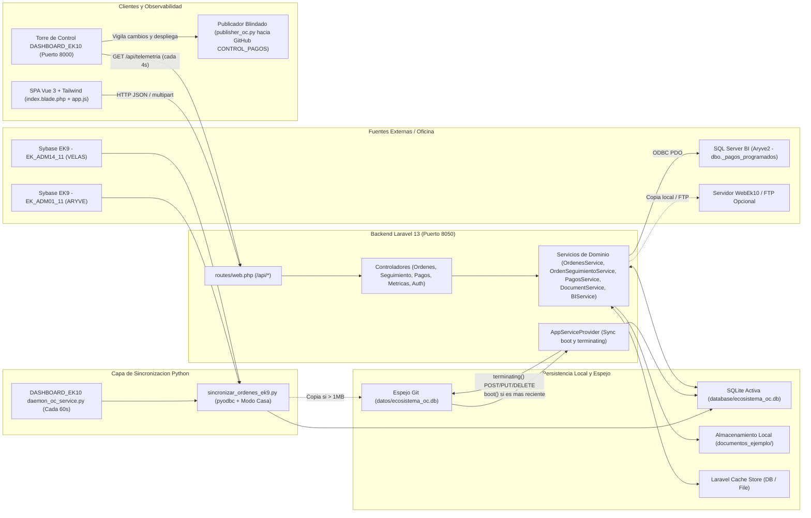
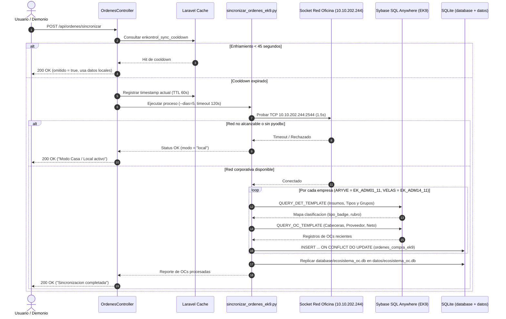
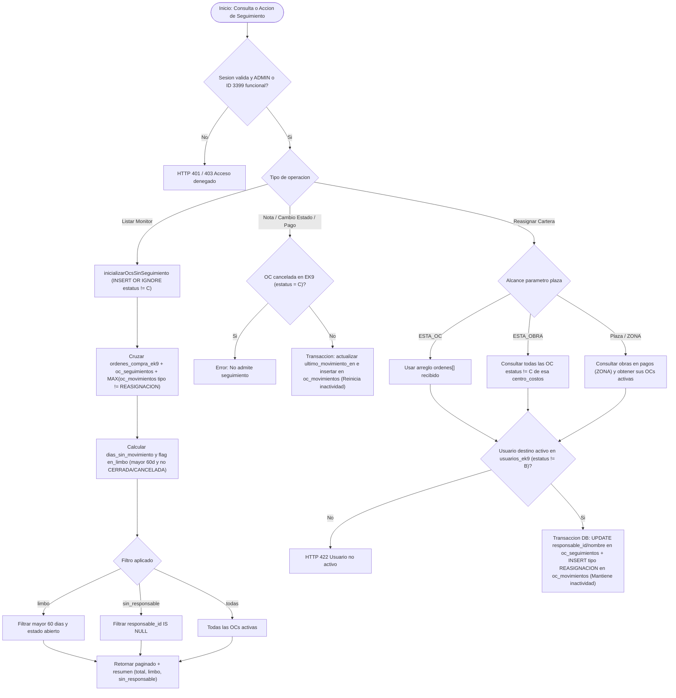
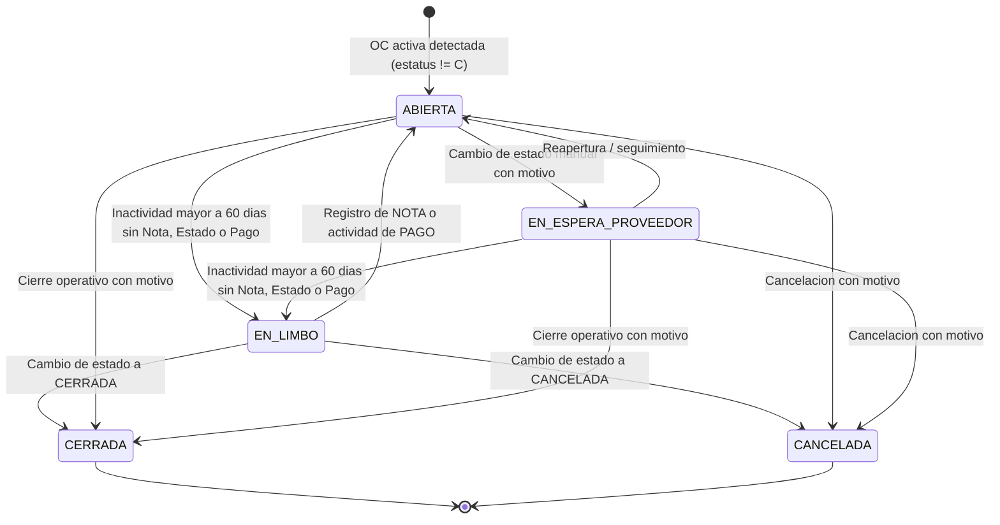
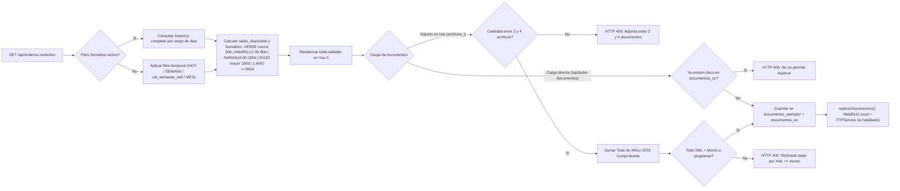
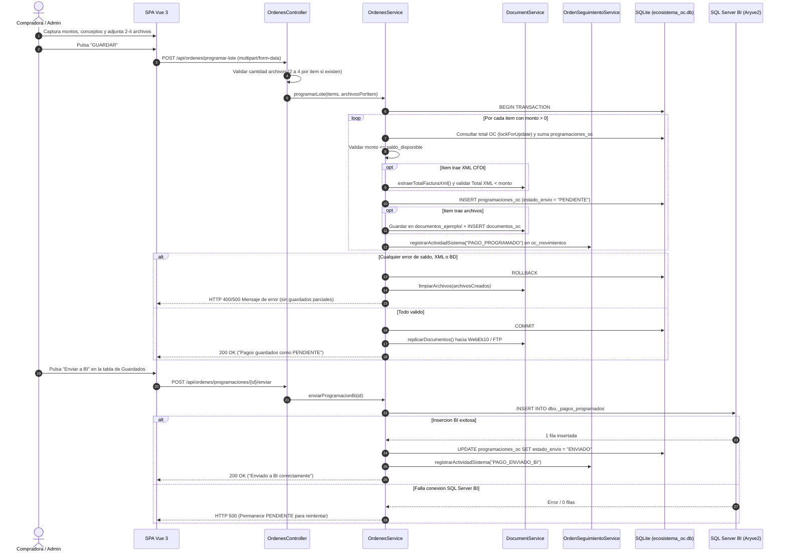
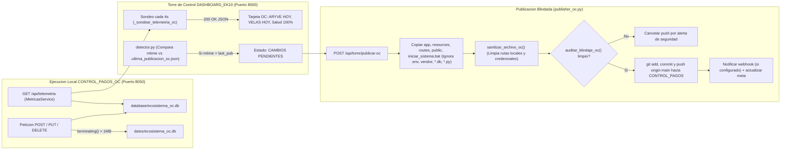
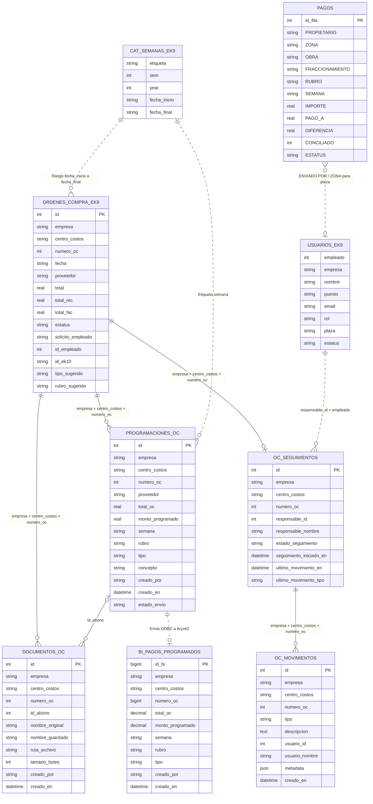

# Documentación Técnica Integral y Diagramas de Procesos — `CONTROL_PAGOS_OC`

> **Sistema:** Control y Conciliación de Pagos y Órdenes de Compra (Grupo Velas & Construcciones Aryve)  
> **Stack Activo:** PHP 8.x / Laravel 13 (`^13.17`) · Vue 3 SPA + Tailwind CSS · SQLite Local (`database/ecosistema_oc.db`) · Sincronizador Python (`pyodbc` -> Sybase SQL Anywhere 11) · SQL Server BI (`Aryve2`)

---

## 1. Resumen Ejecutivo y Arquitectura General

**CONTROL_PAGOS_OC** es la plataforma operativa central encargada de sincronizar las Órdenes de Compra (OC) desde las bases ERP de Enkontrol EK9 (`EK_ADM01_11` para **ARYVE** y `EK_ADM14_11` para **VELAS**), gestionar el control de cartera y seguimiento de inactividad de OCs, recibir expedientes documentales (PDF/XML CFDI), validar saldos reales antes de programar abonos semanales hacia BI (`SQL Server`) y ofrecer el módulo administrativo de conciliación semanal de pagos.

La aplicación opera bajo una **arquitectura monolítica modular en Laravel** servida localmente en `http://127.0.0.1:8050` (mediante `iniciar_sistema.bat`), con un frontend reactivo en **Vue 3** (`resources/views/index.blade.php` y `public/js/app.js`) y persistencia ultra rápida en **SQLite** indexado por árboles B-Tree (`database/ecosistema_oc.db`). Para garantizar portabilidad entre red de oficina, trabajo remoto ("Modo Casa") y control de versiones en Git, el sistema mantiene un espejo sincronizado automático hacia `datos/ecosistema_oc.db`.

### Diagrama de Arquitectura General del Ecosistema

---

## 2. Proceso de Sincronización e Ingesta Híbrida (Enkontrol EK9 ↔ SQLite)

La ingesta de órdenes de compra desde Enkontrol se diseña para resistir desconexiones fuera de la red corporativa sin detener la operación del equipo.

### Mecánica Técnica del Proceso
1. **Disparadores de Sincronización:**
   - **Bajo demanda desde UI:** El usuario pulsa *Refrescar*, disparando `POST /api/ordenes/sincronizar` (`OrdenesController::sincronizarEnkontrol`).
   - **Automática en segundo plano:** En la Torre de Control (`DASHBOARD_EK10/core/daemon_oc_service.py`), un hilo demonio invoca `sincronizar_ordenes_rapido(dias_atras=2)` cada 60 segundos cuando está en modo Master.
2. **Candado de Enfriamiento (Anti-Saturación):**
   - `OrdenesController::sincronizarEnkontrol` verifica la clave `enkontrol_sync_cooldown` en `Cache`. Si transcurrieron menos de **45 segundos** desde la última ejecución, responde `200 OK` (`omitido: true`) reutilizando la base local para proteger el motor Sybase.
3. **Detección de Red de Oficina y Fallback "Modo Local / Casa":**
   - El script `sincronizar_ordenes_ek9.py` (ejecutado con ventana por defecto `--dias=5` y timeout de 120s) abre un socket TCP rápido (timeout `1.5s`) hacia `10.10.202.244:2544`.
   - Si no hay red corporativa o no está instalado `pyodbc`, retorna estado `ok` con `"modo": "local"`, protegiendo la base local existente sin arrojar errores falsos.
4. **Extracción Dual (Detalle + Cabecera) y Reglas de Clasificación:**
   - Consulta de detalle (`QUERY_DET_TEMPLATE`): une `DBA.so_orden_compra_det`, `DBA.insumos`, `DBA.tipos_insumo` y `DBA.grupos_insumo`, determinando para cada OC su `tipo_sugerido` mediante `MAPA_TIPO_BADGE` (por ejemplo `(1) MATERIALES`, `(2) MANO DE OBRA`, `(4) SUB CONTRATOS`) y su `rubro_sugerido` normalizado. Si una OC carece de detalle clasificable, asume respaldo `(1) MATERIALES` / `MATERIALES`.
   - Consulta de cabecera (`QUERY_OC_TEMPLATE`): une `DBA.so_orden_compra`, `DBA.sp_proveedores` y `DBA.empleados`, calculando el importe neto (`total - COALESCE(rentencion_despues_iva,0) - COALESCE(rentencion_antes_iva,0)`). El monto operativo guardado usa `tot_neto or tot_bruto`.
5. **Idempotencia (`UPSERT`) y Espejo:**
   - Inserta o actualiza mediante `ON CONFLICT(empresa, centro_costos, numero_oc) DO UPDATE SET ...`.
   - Al cerrar la conexión SQLite, si `database/ecosistema_oc.db` supera 1 MB, se copia automáticamente a `datos/ecosistema_oc.db`.

### Diagrama de Secuencia — Sincronización Híbrida

---

## 3. Proceso del Monitor de Seguimiento de OCs y Reasignación de Cartera

Implementado en `OrdenSeguimientoController` y `OrdenSeguimientoService` sobre las tablas `oc_seguimientos` y `oc_movimientos` (creadas por la migración `2026_11_17_155519_create_oc_follow_up_tables.php`).

### Propósito del Módulo
Evitar que miles de Órdenes de Compra queden **huérfanas (sin responsable asignado)** o **estancadas en el limbo (> 60 días sin avance)**, manteniendo trazabilidad de notas, cambios de estado y movimientos de pago sin alterar las tablas fuente de Enkontrol (`ordenes_compra_ek9` y `usuarios_ek9`).

### Reglas de Negocio Implementadas
1. **Línea Base Perezosa (`inicializarOcsSinSeguimiento`):**
   - Al consultar el monitor (`GET /api/ordenes/seguimiento`), se ejecuta `INSERT OR IGNORE INTO oc_seguimientos` tomando de `ordenes_compra_ek9` todas las OCs activas (`UPPER(TRIM(COALESCE(estatus, ''))) <> 'C'`).
   - Todas las OCs canceladas en Enkontrol (`estatus = 'C'`) quedan excluidas.
   - El punto de partida (`seguimiento_iniciado_en`) se establece al momento de inicializar la OC en el monitor, sin asumir actividad histórica previa no observada.
2. **Cálculo Exacto de Inactividad (`dias_sin_movimiento`):**
   - Se calcula en SQL como la diferencia en días (`julianday('now')`) respecto a la fecha más reciente entre:
     1. El último registro en `oc_movimientos` cuyo tipo **NO sea `REASIGNACION`** (`WHERE tipo <> 'REASIGNACION'`).
     2. `seg.ultimo_movimiento_en` (si existiera).
     3. `seg.seguimiento_iniciado_en`.
   - **Regla clave:** Reasignar una OC a otro responsable **NO reinicia** el contador de días de inactividad. Únicamente la actividad real (`NOTA`, `CAMBIO_ESTADO`, `PAGO_PROGRAMADO`, `PAGO_ENVIADO_BI`, `PAGO_ELIMINADO`) reinicia la fecha de última actividad.
3. **Detección de "Limbo" (`en_limbo`):**
   - Una OC se marca en alerta de limbo cuando `dias_sin_movimiento > 60` **y** su `estado_seguimiento` NO es `'CERRADA'` ni `'CANCELADA'`.
4. **Control de Acceso y Autorización:**
   - En `OrdenSeguimientoController::contexto(true)`, el acceso a los endpoints `/api/ordenes/seguimiento*` está restringido a usuarios con sesión autenticada cuyo rol sea `'ADMIN'` o bien el empleado `3399` con permiso `usuario_admin_funcional = true`. En la interfaz Vue (`public/js/app.js`), la propiedad computada `puedeReasignarCartera` aplica exactamente esta validación para mostrar el botón `REASIGNAR` en la tabla principal.
   - Adicionalmente, en la capa `OrdenSeguimientoService`, las consultas están preparadas para filtrar por `seg.responsable_id = $empleadoId` y bloquear escritura a terceros cuando `$esAdministrador` es `false`.
5. **Alcances de Reasignación de Cartera (`POST /api/ordenes/seguimiento/reasignar-cartera`):**
   - Desde el modal de reasignación (`#modalReasignacion`, invocado con `abrirMenuReasignacion(oc)` en la columna `REASIGNAR` de la tabla principal), o enviando lotes directos al endpoint, el controlador admite tres alcances según el parámetro `plaza`:
     - **`ESTA_OC` (o lista puntual):** Reasigna el arreglo explícito de OCs enviadas en `ordenes` (límite de validación en controlador: hasta `500` órdenes por solicitud).
     - **`ESTA_OBRA`:** Busca automáticamente en `ordenes_compra_ek9` todas las OCs activas (`estatus <> 'C'`) pertenecientes al `centro_costos` de la OC base.
     - **Plaza específica (`ZONA`):** Consulta las obras distintas registradas para esa `ZONA` en la tabla `pagos` e incluye todas las OCs activas de esas obras.
   - Valida que la persona destino exista y esté activa (`estatus <> 'B'`) en `usuarios_ek9`, actualiza `oc_seguimientos` dentro de una transacción e inserta un registro `REASIGNACION` en `oc_movimientos` guardando en `metadata` JSON los IDs y nombres anterior y nuevo.

### Diagrama de Flujo — Seguimiento de OCs y Reasignación de Cartera

### Diagrama de Estados — Ciclo de Vida en Seguimiento de una OC

---

## 4. Proceso Operativo de Órdenes de Compra, Semáforo de Antigüedad y Expediente Digital

Esta vista (`ORDENES_VIVO` en `index.blade.php` + `OrdenesService::consultarOrdenesRecientes`) concentra la operación diaria de las compradoras y administración.

### Reglas de Consulta y Semáforo de Antigüedad de Adeudo
1. **Prioridad de Filtros:**
   - Si el usuario selecciona un **filtro de Semáforo** (`semaforo`), éste tiene prioridad y consulta todo el histórico de la empresa sin limitarse a "Sólo Hoy".
   - En ausencia de filtro de semáforo, aplica el filtro temporal: `HOY` (`fecha = date('now', 'localtime')`), `SEMANA` (últimos 7 días o semana oficial seleccionada en `cat_semanas_ek9`), o `MES`.
   - Para usuarios no administradores (`mis_ordenes = 1`), restringe a `id_empleado` de su sesión.
2. **Clasificación del Semáforo de Antigüedad (`diasAntiguedad` desde `oc.fecha`):**
   - **LIQUIDADO (`PAGADA`):** Cuando `saldo_disponible <= 0.009` (fila liquidada al 100%).
   - **VERDE (`30d`):** Menor a `30` días (`< 30 días`).
   - **AMARILLO (`30-90d`):** Entre `30` y `90` días inclusive (`>= 30 y <= 90 días`).
   - **NARANJA (`90-180d`):** Mayor a `90` y hasta `180` días (`> 90 y <= 180 días`).
   - **ROJO (`180d` / `1 año`):** Mayor a `180` días (`> 180 días`). Dentro de este bloque existe el sub-filtro de alerta **`MAS_UN_ANO`** (`>= 365 días` / `1 año`) para pasivos críticos con riesgo de reclamo.
3. **Cálculo de Saldo Disponible:**
   - En lectura y antes de guardar pagos, el backend calcula:  
     `saldo_disponible = max(0, total_oc - SUM(programaciones_oc.monto_programado))`.

### Reglas del Expediente Digital (`DocumentService` y `OrdenesController`)
- **Almacenamiento y Nomenclatura:** Los archivos se guardan físicamente en `documentos_ejemplo/` con el patrón `{ccSanitizado}_OC{numeroOc}_{uuid16}_{nombreSanitizado}` y sus metadatos en la tabla `documentos_oc`.
- **Blindaje Anti-Duplicados:** Tanto en carga directa (`POST /api/subir-documentos`) como en lote (`POST /api/ordenes/programar-lote`), el servidor verifica si la tupla `(empresa, centro_costos, numero_oc)` ya cuenta con documentos en `documentos_oc`; de ser así, rechaza la duplicidad (`HTTP 400`).
- **Regla de Carga en Lote (2 a 4 archivos):** Cuando un ítem del lote incluye adjuntos (`archivos_{indice}`), `OrdenesController::programarLote` exige adjuntar entre **2 y 4 documentos**.
- **Validación CFDI XML (`extraerTotalFacturaXml`):** Para cada archivo `.xml` adjunto, valida que la raíz sea `<Comprobante>`, lee su atributo `Total`, acumula el monto facturado y ejecuta `validarTotalXmlMenorPago`, rechazando el registro si la suma de facturas XML es **mayor o igual** al importe a programar.
- **Replicación Externa:** Tras guardar localmente, `DocumentService::replicarDocumentos()` copia los archivos hacia `C:\EnkontrolV9\WebEk10` (si el directorio existe en el servidor) y opcionalmente los transfiere por FTP (`FTPService::subirArchivos` si `FTP_HABILITADO=true`).

### Diagrama de Flujo — Operación Diaria y Gestión Documental

---

## 5. Proceso de Programación de Pagos (Individual / Lote) y Conciliación Semanal

### Flujo de Programación y Despacho a SQL Server BI
El sistema distingue entre la **etapa de captura local (PENDIENTE)** y la **etapa de transmisión oficial a BI (ENVIADO)**:

1. **Programación por Lote (`POST /api/ordenes/programar-lote` / Botón "GUARDAR"):**
   - Inicia una transacción SQL (`DB::beginTransaction()`).
   - Para cada ítem con `monto_programado > 0`:
     - Ejecuta `obtenerTotalYSaldoDisponible()` con bloqueo de fila (`lockForUpdate()`) sobre `ordenes_compra_ek9` (fuente única de verdad; nunca confía en el `total_oc` enviado por el navegador).
     - Valida que el monto sea `> 0`, máximo 2 decimales y `<= saldo_disponible` (`validarMontoContraSaldo`).
     - Valida documentos (no duplicidad y total XML < monto).
     - Inserta en `programaciones_oc` con `estado_envio = 'PENDIENTE'`.
     - Guarda archivos adjuntos en `documentos_oc` vinculados al `id_abono`.
     - Registra el evento `PAGO_PROGRAMADO` en `oc_movimientos` (lo cual actualiza la última actividad de seguimiento de esa OC).
   - Si algún ítem falla, ejecuta `DB::rollBack()` y limpia del disco todos los archivos físicos creados en esa operación (`DocumentService::limpiarArchivos`).
   - Tras `DB::commit()`, ejecuta la réplica externa de documentos.

2. **Envío Individual a BI (`POST /api/ordenes/programaciones/{id}/enviar`):**
   - Toma una fila de `programaciones_oc` en estado `'PENDIENTE'`.
   - Invoca `BIService::insertarLote()` conectándose por PDO ODBC a SQL Server (`10.30.0.2`, base `Aryve2`, tabla `dbo._pagos_programados`).
   - Solo si SQL Server confirma 1 inserción exitosa, actualiza `estado_envio = 'ENVIADO'` y registra `PAGO_ENVIADO_BI` en `oc_movimientos`. Si SQL Server falla, el registro permanece `'PENDIENTE'` para reintento seguro.

3. **Programación de Abono Individual (`POST /api/ordenes/programar-abono`):**
   - Valida saldo dentro de transacción, registra en `programaciones_oc` con `estado_envio = 'ENVIADO'`, registra `PAGO_PROGRAMADO` en seguimiento e intenta inserción inmediata vía `BIService::insertarPago()`.

4. **Eliminación de Abonos (`POST /api/ordenes/eliminar-abono`):**
   - Verifica sesión y lista blanca de usuarios autorizados (`AuthService::puedeBorrarPagosProgramados`).
   - Si estaba `'PENDIENTE'`, borra sus `documentos_oc` asociados y elimina archivos físicos. Si estaba `'ENVIADO'`, invoca además `BIService::eliminarAbono()` en SQL Server. Registra `PAGO_ELIMINADO` en `oc_movimientos`.

### Diagrama de Secuencia — Programación por Lote y Despacho a BI

### Módulo de Conciliación Semanal (`PagosService`)
Accessible para usuarios con privilegio `puede_ver_conciliacion` (`AuthService::esUsuarioAdministradorAutorizado`):
- Consulta la tabla `pagos` filtrando por `PROPIETARIO` (`GVDC` para **VELAS**; `ARYVE`/`Aryve` para **ARYVE**), Plaza (`ZONA`), Rubro (`RUBRO`), Responsable (`ENVIADO POR`), Fraccionamiento y Semana (`SEMANA` + cálculo dinámico de semana ISO vigente en `cat_semanas_ek9`).
- **Caché de Filtros y KPIs:** Almacena los catálogos únicos y totales globales en caché por **300 segundos** (`Cache::remember("filtros_pagos_{$empresa}", 300, ...)`).
- **Conciliación en Tiempo Real (`POST /api/pagos/actualizar`):** Alterna `CONCILIADO` (`1`/`0`) y `ESTATUS` (`APROBADO`/`PENDIENTE`) y limpia caché mediante `Cache::flush()`.
- **Exportación Excel (`GET /api/descargar-excel`):** Genera `storage/app/concentrado_oc_conciliado.csv` con marca BOM UTF-8 para apertura directa con acentos en Excel.

---

## 6. Proceso de Telemetría, Caché, Espejo de BD y Publicación Blindada

`CONTROL_PAGOS_OC` forma parte de un ecosistema coordinado con `DASHBOARD_EK10` (Torre de Control en el puerto `8000`) y el repositorio limpio de producción/servidor `CONTROL_PAGOS`.

### Flujos de Sincronización Operativa y Despliegue
1. **Telemetría en Tiempo Real:**
   - `DASHBOARD_EK10/api/main.py` (`_sondear_telemetria_oc`) consulta cada **4 segundos** el endpoint `GET http://127.0.0.1:8050/api/telemetria` (`MetricasController::telemetria`).
   - `MetricasService::obtenerTelemetria()` reporta salud (`100%`), versión, latencia de SQLite en ms, conteo de OCs del día actual por empresa (`ocs_hoy_aryve`, `ocs_hoy_velas`), acumulados totales, historial de los últimos 5 días con fecha y conteo de registros en `pagos`.
2. **Espejo Automático de Base de Datos (`AppServiceProvider` + `iniciar_sistema.bat`):**
   - Al arrancar (`iniciar_sistema.bat` y `AppServiceProvider::boot()`), si `datos/ecosistema_oc.db` (> 1 MB) es más reciente que `database/ecosistema_oc.db` (ej. tras hacer `git pull`), restaura `database/ecosistema_oc.db` automáticamente.
   - Al finalizar cualquier petición HTTP de escritura (`POST`, `PUT`, `DELETE`), el hook `$this->app->terminating()` de `AppServiceProvider` copia `database/ecosistema_oc.db` hacia `datos/ecosistema_oc.db` para que Git detecte los cambios persistidos.
3. **Detección de Cambios y Publicación Blindada (`detector.py` + `publisher_oc.py`):**
   - `DASHBOARD_EK10/Shared/detector.py` (`obtener_estado_oc_publicacion`) compara el `mtime` de los archivos fuente en `CONTROL_PAGOS_OC` contra `.ultima_publicacion_oc.json`. Si detecta cambios posteriores, muestra la alerta **CAMBIOS PENDIENTES** en la tarjeta `OC` de la Torre de Control.
   - Al ejecutar *ACTUALIZAR EQUIPO* (`POST /api/torre/publicar-oc` -> `publisher_oc.py::publicar_control_pagos()`):
     1. Copia carpetas productivas Laravel (`app`, `bootstrap`, `config`, `database`, `public`, `resources`, `routes`, `docs`) y archivos raíz esenciales (incluyendo `iniciar_sistema.bat`), excluyendo archivos `.env`, `vendor`, `node_modules`, `storage`, bases `*.db/*.sqlite` y residuos legacy de Python/Docker.
     2. Ejecuta `sanitizar_archivo_oc()` eliminando rutas locales (`....`) y posibles tokens o correos maestros.
     3. Audita el destino con `auditar_blindaje_oc()`; si detecta un rastro prohibido, aborta el despliegue.
     4. Ejecuta `git add -A`, `git commit` y `git push origin main` hacia el repositorio de `CONTROL_PAGOS`, y notifica al webhook si existe `CONTROL_PAGOS_DEPLOY_WEBHOOK`.

### Diagrama de Flujo — Telemetría y Pipeline de Publicación Blindada

---

## 7. Modelo de Datos y Diccionario de Tablas

La correspondencia entre órdenes, seguimientos, programaciones y documentos se resuelve mediante la llave lógica compuesta **`(empresa, centro_costos, numero_oc)`** para mantener independencia ante actualizaciones de SQLite y re-sincronizaciones desde Enkontrol.

### Diagrama Entidad-Relación (`erDiagram`)

### Diccionario Técnico de Tablas

| Tabla / Destino | Motor / Ubicación | Origen de Escritura | Función y Reglas Clave |
| :--- | :--- | :--- | :--- |
| `ordenes_compra_ek9` | SQLite (`ecosistema_oc.db`) | `sincronizar_ordenes_ek9.py` | Réplica incremental de Enkontrol EK9. Índice único `(empresa, centro_costos, numero_oc)`. Índices B-Tree por empleado, fecha, número OC e `id_ek10`. |
| `oc_seguimientos` | SQLite (`ecosistema_oc.db`) | `OrdenSeguimientoService` | Estado operativo actual (`ABIERTA`, `EN_ESPERA_PROVEEDOR`, `CERRADA`, `CANCELADA`), responsable asignado e inicio de monitoreo. Índice único `(empresa, centro_costos, numero_oc)`. |
| `oc_movimientos` | SQLite (`ecosistema_oc.db`) | `OrdenSeguimientoService` / `OrdenesService` | Bitácora inmutable de eventos (`NOTA`, `CAMBIO_ESTADO`, `REASIGNACION`, `PAGO_PROGRAMADO`, `PAGO_ENVIADO_BI`, `PAGO_ELIMINADO`) con `metadata` JSON. |
| `programaciones_oc` | SQLite (`ecosistema_oc.db`) | `OrdenesService` | Abonos y lotes programados. Columna `estado_envio` distingue `'PENDIENTE'` (solo local) vs `'ENVIADO'` (confirmado en BI). |
| `documentos_oc` | SQLite (`ecosistema_oc.db`) | `DocumentService` | Metadatos de los archivos guardados en `documentos_ejemplo/`. Sirve como candado anti-duplicidad por OC. |
| `usuarios_ek9` | SQLite (`ecosistema_oc.db`) | Sincronizador de usuarios EK9 | Catálogo local de autenticación y compradoras activas (`estatus <> 'B'`). |
| `pagos` | SQLite (`ecosistema_oc.db`) | `indexador.py` / `PagosService` | Base histórica y semanal para la vista de Conciliación de Pagos y filtro de obras por Plaza (`ZONA`). |
| `cat_semanas_ek9` | SQLite (`ecosistema_oc.db`) | Catálogo / `PagosService` | Fechas de corte lunes-domingo (`fecha_inicio`, `fecha_final`) y etiquetas `SEM: N-YYYY`. Autogenera la semana en curso si falta. |
| `dbo._pagos_programados` | SQL Server (`Aryve2` en `10.30.0.2`) | `BIService` | Tabla receptora en BI alimentada al confirmar envío individual (`enviarProgramacionBi`) o abono directo (`programarAbono`). |

---

## 8. Catálogo Consolidado de Endpoints REST

Todas las rutas se definen en `routes/web.php` bajo el prefijo `/api` (excepto la vista SPA principal `/`):

| Método | Ruta | Controlador @ Método | Acceso / Reglas | Propósito Técnico |
| :--- | :--- | :--- | :--- | :--- |
| `GET` | `/` | `HomeController@index` | Público (SPA) | Renderiza `index.blade.php` con headers `no-store` e inyecta configuración y permiso `puedeBorrarPagosSesion`. |
| `POST` | `/api/login` | `AuthController@login` | Público | Valida credenciales contra `usuarios_ek9` (bloquea estatus `B`) o acceso `ADMIN`; inicia sesión PHP. |
| `POST` | `/api/logout` | `AuthController@logout` | Sesión activa | Limpia todas las variables de sesión (`Session::flush()`). |
| `GET` | `/api/ordenes-recientes` | `OrdenesController@recientes` | Autenticado | Consulta paginada de OCs con saldo calculado, semáforo de antigüedad, KPIs del día/semáforo, programaciones y conteo documental. |
| `GET` | `/api/ordenes/catalogo-obras` | `OrdenesController@catalogoObras` | Autenticado | Lista ordenada de `centro_costos` disponibles para la empresa activa. |
| `POST` | `/api/ordenes/sincronizar` | `OrdenesController@sincronizarEnkontrol` | Autenticado | Dispara `sincronizar_ordenes_ek9.py --dias=5` protegido con cooldown de 45 segundos. |
| `POST` | `/api/ordenes/programar-lote` | `OrdenesController@programarLote` | Autenticado | Recibe `multipart/form-data` (`items` + `archivos_i`). Valida saldo en BD, 2–4 archivos, XML < monto y guarda como `PENDIENTE`. |
| `POST` | `/api/ordenes/programar-abono` | `OrdenesController@programarAbono` | Autenticado | Registra un abono individual validado como `ENVIADO` e intenta replicar a SQL Server BI. |
| `GET` | `/api/ordenes/programaciones-semana` | `OrdenesController@programacionesSemana` | Autenticado | Lista programaciones filtradas por empresa, semana y obra con flag `es_pendiente` y conteo de documentos. |
| `POST` | `/api/ordenes/programaciones/{id}/enviar` | `OrdenesController@enviarProgramacionBi` | Autenticado | Transmite a `BIService` una fila `PENDIENTE`; actualiza a `ENVIADO` y registra actividad en seguimiento. |
| `POST` | `/api/ordenes/eliminar-abono` | `OrdenesController@eliminarAbono` | Lista blanca `AuthService` | Elimina un abono (y sus archivos si era `PENDIENTE`, o su fila en BI si era `ENVIADO`). |
| `POST` | `/api/subir-documentos` | `OrdenesController@subirDocumentos` | Autenticado | Adjunta comprobantes directos a una OC bloqueando si ya cuenta con archivos en `documentos_oc`. |
| `GET` | `/api/documentos-oc` | `OrdenesController@documentosOc` | Autenticado | Lista metadatos de documentos adjuntos a una `(empresa, centro_costos, numero_oc)`. |
| `GET` | `/api/descargar-archivo-oc/{id}` | `OrdenesController@descargarArchivoOc` | Autenticado | Descarga archivo físico buscando en ruta original, `documentos_ejemplo/` o `C:\EnkontrolV9\WebEk10`. |
| `GET` | `/api/ordenes/seguimiento` | `OrdenSeguimientoController@index` | Admin autorizado | Lista paginada con `dias_sin_movimiento`, flag `en_limbo` (> 60d) y totales resumen (`total`, `limbo`, `sin_responsable`). |
| `GET` | `/api/ordenes/seguimiento/compradoras` | `OrdenSeguimientoController@compradoras` | Admin autorizado | Obtiene usuarios activos (`estatus <> 'B'`) de `usuarios_ek9` (priorizando puesto `%COMPRADOR%`). |
| `GET` | `/api/ordenes/seguimiento/historial` | `OrdenSeguimientoController@historial` | Admin autorizado | Últimos 30 eventos en `oc_movimientos` para una OC específica. |
| `POST` | `/api/ordenes/seguimiento/nota` | `OrdenSeguimientoController@nota` | Admin autorizado | Registra movimiento tipo `NOTA` (mín. 3 caracteres) y reinicia inactividad. |
| `POST` | `/api/ordenes/seguimiento/estado` | `OrdenSeguimientoController@estado` | Admin autorizado | Cambia estado (`ABIERTA`, `EN_ESPERA_PROVEEDOR`, `CERRADA`, `CANCELADA`) con motivo obligatorio. |
| `POST` | `/api/ordenes/seguimiento/reasignar-cartera` | `OrdenSeguimientoController@reasignarCartera` | Admin autorizado | Reasigna cartera (`ESTA_OC`, `ESTA_OBRA` o por Plaza `ZONA`) registrando bitácora sin reiniciar inactividad. |
| `GET` | `/api/filtros` | `PagosController@filtros` | Admin Conciliación | Retorna catálogos únicos de conciliación, `semana_actual` y KPIs cacheados 300s. |
| `GET` | `/api/pagos` | `PagosController@index` | Admin Conciliación | Consulta paginada de la tabla `pagos` filtrada por plaza, obra, rubro, responsable y semana. |
| `POST` | `/api/pagos/actualizar` | `PagosController@actualizar` | Admin Conciliación | Marca/desmarca `CONCILIADO` (`APROBADO`/`PENDIENTE`) y limpia caché. |
| `POST` | `/api/pagos/programar` | `PagosController@programar` | Admin Conciliación | Inserta una fila manual directamente en la tabla `pagos` y limpia caché. |
| `GET` | `/api/descargar-excel` | `OrdenesController@descargarExcel` | Admin Conciliación | Exporta `concentrado_oc_conciliado.csv` (UTF-8 BOM) con los filtros aplicados. |
| `GET` | `/api/telemetria` | `MetricasController@telemetria` | Torre de Control | Expone estado `OPERATIVO`, salud, latencia DB y conteos diarios/históricos para `DASHBOARD_EK10`. |
| `POST` | `/api/limpiar-cache` | `MetricasController@limpiarCache` | Operación | Limpia `Cache::flush()`. |
| `POST` | `/api/reindexar` | `MetricasController@reindexar` | Operación | Limpia caché para forzar recálculo de consultas sobre B-Tree. |
