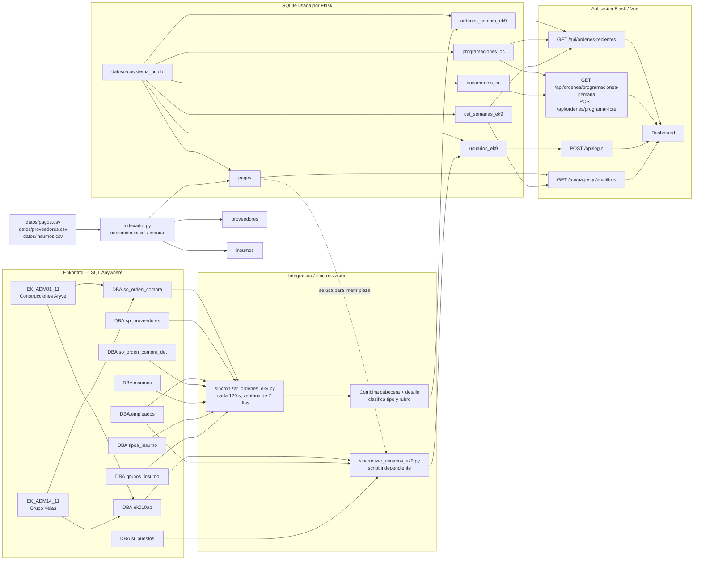
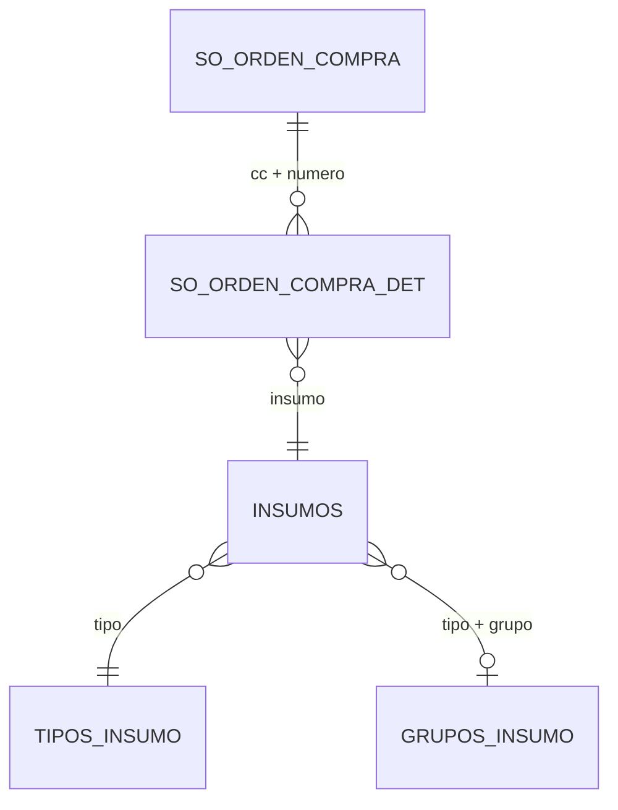
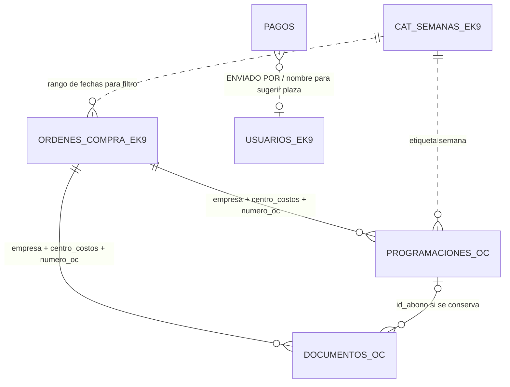

# Flujo de datos y tablas — Control de Pagos OC

Este documento describe cómo los datos de Enkontrol llegan a las vistas de la aplicación, qué consultas los alimentan y dónde se transforman. Se basa en las consultas y flujos implementados en el repositorio.

> No incluye credenciales. Los nombres de las bases externas y la asignación de empresa se tomaron de los scripts de sincronización.

## 1. Vista general del flujo



### Bases externas identificadas

| Base de Enkontrol | Empresa que le asigna el sincronizador |
|---|---|
| `EK_ADM01_11` | `ARYVE` — Construcciones Aryve |
| `EK_ADM14_11` | `VELAS` — Grupo Velas |

El código usa conexiones ODBC a SQL Anywhere. La configuración de red y conexión está en los scripts de sincronización; este documento omite usuarios, contraseñas y otros datos de autenticación.

## 2. Consulta de órdenes de compra a Enkontrol

El script `sincronizar_ordenes_ek9.py` hace dos consultas por empresa. Ambas limitan los registros a una fecha de inicio. La sincronización periódica calcula ese inicio como siete días antes del día actual.

### 2.1 Cabecera de la OC

La consulta `QUERY_OC_TEMPLATE` usa estas tablas:

| Tabla Enkontrol | Alias | Uso / columnas que aporta |
|---|---|---|
| `DBA.so_orden_compra` | `oc` | Tabla principal. `cc` (obra/centro de costos), `numero`, `fecha`, `proveedor`, `total`, retenciones, `total_rec`, `total_fac`, `estatus`, `solicito`, `ID_EK10` y `comentarios`. |
| `DBA.sp_proveedores` | `p` | `p.nombre`, unida con `oc.proveedor = p.numpro`. |
| `DBA.empleados` | `e` | `e.descripcion` del solicitante, unida con `oc.solicito = e.empleado`. |

Campos derivados en esta consulta:

- **Importe bruto:** `oc.total`.
- **Importe neto:** `oc.total` menos `rentencion_despues_iva` y `rentencion_antes_iva` (ambas retenciones se convierten a cero si son nulas).
- **Importe usado por la aplicación:** importe neto; si es nulo o cero, se usa el bruto.
- **Recibido:** `oc.total_rec`.
- **Facturado:** `oc.total_fac`.

### 2.2 Detalle para sugerir tipo y rubro

La consulta `QUERY_DET_TEMPLATE` sigue estas relaciones:



| Tabla Enkontrol | Alias | Uso |
|---|---|---|
| `DBA.so_orden_compra_det` | `d` | Partidas de la OC: obra, número, insumo e importe. Se enlaza con la cabecera por `cc` y `numero`. |
| `DBA.insumos` | `i` | Proporciona los identificadores de tipo y grupo del insumo (`tipo`, `grupo`). |
| `DBA.tipos_insumo` | `ti` | Traduce el tipo a una descripción mediante `i.tipo = ti.tipo_insumo`. |
| `DBA.grupos_insumo` | `gi` | Traduce el grupo a una descripción mediante tipo y grupo. |

El sincronizador usa el detalle para asignar el tipo y el rubro sugeridos a cada OC. El tipo se traduce a una etiqueta como `(2) MANO DE OBRA`; el rubro utiliza la descripción del grupo. Si no obtiene una clasificación para la OC, utiliza valores de respaldo: `(1) MATERIALES` y `MATERIALES`.

### 2.3 Cómo se actualiza una OC

El sincronizador mantiene la correspondencia por **empresa + obra (`cc`) + número de OC**. Inserta una OC nueva o actualiza los campos de una existente. Así, al volver a consultar una OC dentro de la ventana incremental, sus importes, estatus y clasificaciones se refrescan.

## 3. Consulta de usuarios

`sincronizar_usuarios_ek9.py` consulta ambas bases de Enkontrol, separándolas como `ARYVE` y `VELAS`.

| Tabla Enkontrol | Uso |
|---|---|
| `DBA.ek010ab` | Usuario: número de empleado, nombre, correo, contraseña y estatus. |
| `DBA.empleados` | Relaciona el usuario con el puesto. |
| `DBA.si_puestos` | Descripción del puesto. |

Los usuarios se relacionan por número de empleado. El script sincroniza usuarios que tienen contraseña y los marca con la empresa de la base de origen. El login (`/api/login`) consulta los datos sincronizados, no hace una consulta directa a Enkontrol en cada intento.

Además, el script calcula una plaza predominante usando `pagos.[ENVIADO POR]` y `pagos.ZONA`. Esta parte toma datos de la tabla local `pagos`; no es una consulta a una tabla de plazas de Enkontrol.

**Ejecución:** este script es independiente del demonio de órdenes iniciado por `run.py`. Ejecutarlo para actualizar usuarios requiere iniciar `sincronizar_usuarios_ek9.py` por separado.

## 4. De la consulta al dashboard

```mermaid
sequenceDiagram
    participant EK as Enkontrol EK9
    participant S as Sincronizador ODBC
    participant DB as SQLite
    participant R as Repository / Service Flask
    participant UI as Dashboard Vue

    loop Cada 120 segundos
        S->>EK: Consulta cabeceras y detalles desde hace 7 días
        EK-->>S: OC, proveedor, solicitante, partidas e insumos
        S->>S: Asigna empresa; calcula neto; sugiere tipo y rubro
        S->>DB: Inserta o actualiza por empresa + obra + número OC
    end

    UI->>R: GET /api/ordenes-recientes con filtros
    R->>DB: Lee ordenes_compra_ek9 y semana
    R->>DB: Lee programaciones_oc y documentos_oc por OC
    DB-->>R: Órdenes, saldo y conteo de documentos
    R-->>UI: JSON paginado para la tabla

    UI->>R: POST /api/ordenes/programar-lote al guardar el lote
    R->>DB: Inserta pagos como PENDIENTE en programaciones_oc
    opt Documentos habilitados
        R->>DB: Registra metadatos en documentos_oc y guarda archivos
    end
    UI->>R: POST /api/ordenes/programaciones/id/enviar al pulsar Enviar
    R->>BI: Inserta el pago en SQL Server
    R->>DB: Cambia estado_envio a ENVIADO
```

### Filtros de la consulta de órdenes

La ruta `/api/ordenes-recientes` pasa los filtros al repositorio, que consulta `ordenes_compra_ek9`:

- Empresa (`ARYVE` o `VELAS`).
- Solicitante, cuando se limita a “mis órdenes”.
- Semana de corte, resuelta con el catálogo `cat_semanas_ek9`.
- Clave de obra (`centro_costos`).
- Texto de búsqueda sobre número OC, proveedor, obra, folio EK10 o comentarios.
- Paginación.

Al presentar cada OC, la aplicación también lee `programaciones_oc` para calcular:

`saldo disponible = importe de la OC - suma de montos programados`

## 5. Tablas que consume o mantiene la aplicación

| Tabla SQLite | Origen / escritura | Función |
|---|---|---|
| `ordenes_compra_ek9` | Sincronizador de Enkontrol | Datos de cabecera y clasificación de las OCs que alimentan la vista principal. |
| `programaciones_oc` | Escritura de Flask al guardar pagos | Cada pago programado; incluye empresa, obra, número OC, importe, semana, rubro, concepto y quién lo registró. |
| `documentos_oc` | Escritura de Flask cuando la carga está habilitada | Metadatos de archivos asociados a una OC y a un abono. La consulta del tablero cuenta los documentos por empresa + obra + OC. |
| `usuarios_ek9` | Script independiente de sincronización de usuarios | Usuarios, empresa, puesto, plaza y estatus usados por el login. |
| `pagos` | `datos/pagos.csv`, mediante `indexador.py` | Datos de la sección de conciliación y fuente local usada para sugerir plaza en la sincronización de usuarios. |
| `cat_semanas_ek9` | Leída por órdenes y conciliación | Etiquetas y fechas de semana para filtros y semana oficial de corte. El origen que la carga no está identificado en el flujo de sincronización descrito aquí. |
| `proveedores`, `insumos` | CSV correspondientes, mediante `indexador.py` | Catálogos locales; no son las tablas de proveedor e insumo consultadas por el sincronizador de órdenes a Enkontrol. |

`pagos` y `programaciones_oc` son conceptos distintos: `pagos` alimenta la vista de conciliación; `programaciones_oc` contiene los pagos que las usuarias capturan para las OCs de Enkontrol.

### Relaciones locales principales



La relación entre la OC y sus programaciones/documentos se consulta mediante los tres campos indicados, no mediante una llave foránea declarada. `documentos_oc` también almacena `id_abono`; sin embargo, el conteo que muestra la tabla de guardados se calcula por empresa, obra y OC. `pagos` y `usuarios_ek9` no tienen una llave relacional formal: el script de usuarios compara nombres de responsable para inferir la plaza predominante.

## 6. Documentos adjuntos y modo de pruebas

La configuración actual establece `DOCUMENTOS_HABILITADOS = False` en `app/config.py`. En ese modo, los archivos que se preparan en la interfaz quedan temporalmente en memoria del navegador; no se envían a Flask ni se insertan en `documentos_oc`. El indicador temporal de la interfaz desaparece al recargar la página.

Cuando la carga de documentos está habilitada, Flask recibe los archivos con el lote, los guarda como archivos y registra sus metadatos en `documentos_oc`. Esta operación no forma parte de la consulta de órdenes a Enkontrol.

## 7. Frecuencia y rutas

| Proceso | Cómo se ejecuta | Alcance |
|---|---|---|
| Sincronización de órdenes | Demonio iniciado por `run.py` | Cada 120 segundos; vuelve a consultar los últimos 7 días. |
| Sincronización manual de órdenes | `GET` o `POST /api/sincronizar-vivo`; también `sync=1` en `/api/ordenes-recientes` | Usa el servicio incremental de órdenes. |
| Sincronización de usuarios | Ejecutar `sincronizar_usuarios_ek9.py` por separado | Recrea la tabla local de usuarios usando los dos directorios de Enkontrol. |
| Indexación CSV | `indexador.py` | Carga pagos, proveedores e insumos desde CSV a SQLite. |

## Referencias de implementación

- Conexiones y consultas Sybase de órdenes: `sincronizar_ordenes_ek9.py`.
- Conexiones y consulta de usuarios: `sincronizar_usuarios_ek9.py`.
- Disparador y periodicidad del demonio: `run.py` y `app/modules/sincronizacion/service.py`.
- API y consultas de órdenes: `app/modules/ordenes/routes.py` y `app/modules/ordenes/repository.py`.
- Login: `app/modules/auth/routes.py`.
- Indexación CSV: `indexador.py`.
- Configuración de la ruta SQLite y bandera de documentos: `app/config.py`.
